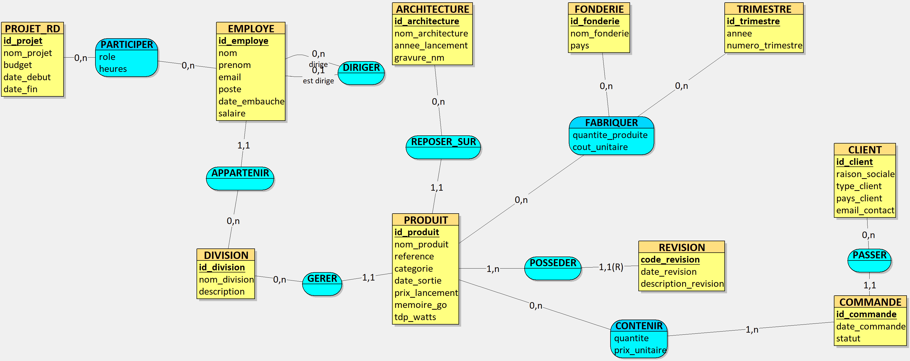
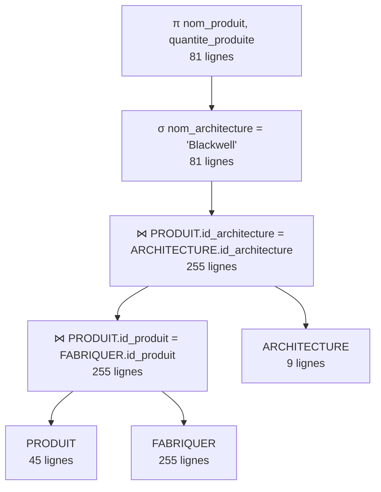
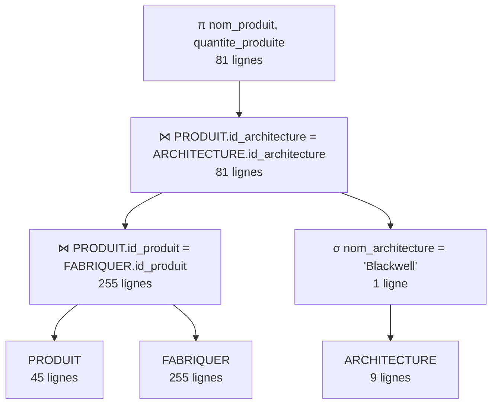
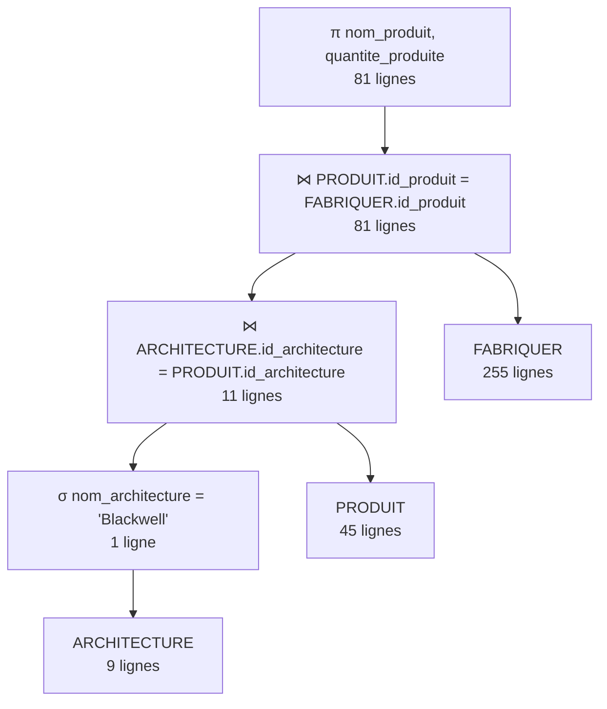

# Base de données NVIDIA – Mini-projet TI503N

Mini-projet du module **TI503N – Bases de données 1** (EFREI) : conception et développement d'une base de données relationnelle avec la méthode **MERISE**, pour l'entreprise **NVIDIA Corporation**.

## Sommaire

1. [Organisation du dépôt](#organisation-du-dépôt)
2. [Exécution des scripts](#exécution-des-scripts)
3. [Étape 1 – Analyse des besoins](#étape-1--analyse-des-besoins)
4. [Étape 2 – MCD](#étape-2--mcd)
5. [Étape 3 – MLD et MPD](#étape-3--mld-et-mpd)
6. [Étape 4 – Insertion des données](#étape-4--insertion-des-données)
7. [Étape 5 – Interrogation de la base](#étape-5--interrogation-de-la-base)
8. [Étude des plans d'exécution](#étude-des-plans-dexécution)
9. [Bilan critique](#bilan-critique)

---

## Organisation du dépôt

```
.
├── README.md                          documentation du projet
├── prompts/
│   ├── 1_prompt_analyse_besoins.txt   prompt RICARDO de l'étape 1
│   └── 2_prompt_insertion.txt         prompt RICARDO de l'étape 4
├── mcd/
│   ├── mcd.loo                        fichier source Looping du MCD
│   └── mcd.png                        image du MCD
└── sql/
    ├── 1_creation.sql                 MPD : tables + contraintes d'intégrité
    ├── 2_contraintes.sql              contraintes de validation
    ├── 3_insertion.sql                jeu de données
    ├── 4_interrogation.sql            requêtes du scénario d'utilisation
    └── 5_demo_video.sql               démonstrations utilisées dans la vidéo
```

## Exécution des scripts

Les scripts sont écrits pour **MySQL 8.0.16 ou plus récent** (nécessaire pour que les contraintes `CHECK` soient appliquées). Ils s'exécutent dans l'ordre suivant :

```bash
mysql -u root -p < sql/1_creation.sql
mysql -u root -p < sql/2_contraintes.sql
mysql -u root -p < sql/3_insertion.sql
mysql -u root -p < sql/4_interrogation.sql
```

Dans MySQL Workbench : *File → Open SQL Script*, puis l'icône éclair pour exécuter le script entier. `1_creation.sql` supprime et recrée la base `nvidia_db`, ce qui permet de repartir de zéro à tout moment.

---

## Étape 1 – Analyse des besoins

### Prompt utilisé

Le prompt complet suit le framework **RICARDO** (Rôle, Instructions, Contexte, Contraintes additionnelles, Références, Rendement désiré, Objectifs). Il se trouve dans [`prompts/1_prompt_analyse_besoins.txt`](prompts/1_prompt_analyse_besoins.txt).

Éléments ajoutés à la base de prompt :

- **Contexte** : NVIDIA ne possède pas d'usine et confie la fabrication à des fonderies (TSMC, Samsung). Ses produits reposent sur des architectures successives (Ampere, Hopper, Blackwell…). Ses clients sont des OEM, des fournisseurs de cloud, des distributeurs et des entreprises. Une puce passe par plusieurs révisions (*steppings*).
- **Références** : site officiel de NVIDIA, site investisseurs, page des technologies, page Wikipédia.
- **Contraintes** : entre 40 et 60 données, noms en minuscules sans accent, respect de la 3FN, modèle permettant une réflexive, une ternaire et une entité faible.

### Ajustements apportés au résultat

- Les données **calculables** ont été retirées pour respecter la 3FN : montant total d'une commande (somme des `quantite × prix_unitaire`), nombre d'employés d'une division, ancienneté d'un employé.
- Le **prix de vente** (`prix_unitaire` dans une commande) est conservé séparément du **prix de lancement** du produit. Ce n'est pas une redondance : le prix négocié varie d'une commande à l'autre.
- Les valeurs codées (catégorie, type de client, statut, rôle) sont écrites **sans accent** afin de simplifier les contraintes `CHECK` et les requêtes.

### Règles métier

**Organisation**

- **RG1** – Une division est identifiée par un numéro. Son nom est unique.
- **RG2** – Un employé appartient à une et une seule division. Une division compte zéro, un ou plusieurs employés.
- **RG3** – L'email professionnel d'un employé est unique et respecte le format `prenom.nom@nvidia.com`.
- **RG4** – Le salaire annuel brut d'un employé est compris entre 30 000 $ et 1 000 000 $.
- **RG5** – NVIDIA a été fondée le 5 avril 1993 : aucune date d'embauche n'est antérieure.
- **RG6** – Un employé est dirigé par au plus un manager, qui est lui-même un employé. Un manager dirige zéro, un ou plusieurs employés. Un employé ne peut pas être son propre manager.
- **RG7** – La directrice générale n'a pas de manager.

**Produits**

- **RG8** – Une architecture (Ampere, Hopper, Blackwell…) a un nom unique. Elle peut servir de base à zéro, un ou plusieurs produits.
- **RG9** – La finesse de gravure d'une architecture est comprise entre 2 et 200 nm. Son année de lancement est comprise entre 1993 et 2030.
- **RG10** – Un produit a une référence commerciale unique de la forme `XX-XXXX` (deux lettres majuscules, un tiret, des lettres ou des chiffres), par exemple `GF-4090`.
- **RG11** – La catégorie d'un produit est l'une des valeurs suivantes : GPU, Accelerateur, SoC, Superpuce, Reseau.
- **RG12** – Le prix de lancement est strictement positif. Le TDP (consommation) est compris entre 1 et 2000 W. La mémoire, si elle est renseignée, est positive ou nulle.
- **RG13** – Un GPU ou un accélérateur possède obligatoirement de la mémoire (> 0 Go).
- **RG14** – Une révision de puce est identifiée par son code (A0, A1, B0… : une lettre majuscule puis un chiffre) **relativement au produit** auquel elle appartient. Un produit a une ou plusieurs révisions. Une révision appartient à un seul produit.
- **RG15** – Un produit repose sur une et une seule architecture. Il est géré par une et une seule division. Une division gère zéro, un ou plusieurs produits.

**Production**

- **RG16** – Une fonderie est identifiée par un numéro. Son nom est unique.
- **RG17** – Un trimestre est défini par une année et un numéro compris entre 1 et 4. Le couple (année, numéro) est unique.
- **RG18** – Pour un produit, une fonderie et un trimestre donnés, on enregistre la quantité produite et le coût unitaire de fabrication. Un même produit peut être fabriqué par plusieurs fonderies au cours d'un même trimestre.
- **RG19** – La quantité produite et le coût unitaire sont strictement positifs.

**Ventes**

- **RG20** – Le type d'un client est l'un des suivants : OEM, Cloud, Distributeur, Entreprise.
- **RG21** – L'email de contact d'un client contient un `@` suivi d'un nom de domaine.
- **RG22** – Le statut d'une commande est l'un des suivants : En attente, Validee, Expediee, Livree, Annulee. Une nouvelle commande est « En attente » par défaut.
- **RG23** – Une commande est passée par un et un seul client. Un client passe zéro, une ou plusieurs commandes.
- **RG24** – Une commande contient un ou plusieurs produits. Pour chaque produit commandé, on enregistre une quantité (≥ 1) et le prix unitaire négocié (> 0).
- **RG25** – Un produit figure dans zéro, une ou plusieurs commandes.

**Recherche & développement**

- **RG26** – Un projet de R&D a une date de début et une date de fin éventuelle (vide si le projet est en cours). La date de fin ne peut pas précéder la date de début.
- **RG27** – Le budget d'un projet est strictement positif.
- **RG28** – Un employé participe à zéro, un ou plusieurs projets. Un projet compte zéro, un ou plusieurs participants. Pour chaque participation, on enregistre un rôle (Chef de projet, Ingenieur, Chercheur, Testeur, Designer).
- **RG29** – Le nombre d'heures déclarées par un employé sur un projet est compris entre 0 et 2000. Il vaut 0 par défaut.

### Dictionnaire de données

Types : A = alphanumérique, N = numérique, D = date.

| Code | Signification | Type | Taille | Remarque / contrainte |
|---|---|---|---|---|
| id_division | Identifiant de la division | N | | Identifiant |
| nom_division | Nom de la division | A | 50 | Unique (RG1) |
| description | Description de la division | A | 255 | Facultatif |
| id_employe | Identifiant de l'employé | N | | Identifiant |
| nom | Nom de famille de l'employé | A | 50 | Obligatoire |
| prenom | Prénom de l'employé | A | 50 | Obligatoire |
| email | Email professionnel | A | 100 | Unique, `prenom.nom@nvidia.com` (RG3) |
| poste | Intitulé du poste | A | 80 | Obligatoire |
| date_embauche | Date d'embauche | D | | ≥ 05/04/1993 (RG5) |
| salaire | Salaire annuel brut en $ | N | 10,2 | 30 000 à 1 000 000 (RG4) |
| id_architecture | Identifiant de l'architecture | N | | Identifiant |
| nom_architecture | Nom de l'architecture | A | 50 | Unique (RG8) |
| annee_lancement | Année de lancement de l'architecture | N | 4 | 1993 à 2030 (RG9) |
| gravure_nm | Finesse de gravure en nanomètres | N | 3 | 2 à 200 (RG9) |
| id_produit | Identifiant du produit | N | | Identifiant |
| nom_produit | Nom commercial du produit | A | 80 | Obligatoire |
| reference | Référence commerciale | A | 20 | Unique, format `XX-XXXX` (RG10) |
| categorie | Catégorie du produit | A | 20 | Liste de valeurs (RG11) |
| date_sortie | Date de sortie commerciale | D | | Obligatoire |
| prix_lancement | Prix de lancement en $ | N | 10,2 | > 0 (RG12) |
| memoire_go | Mémoire embarquée en Go | N | 4 | ≥ 0, obligatoire pour GPU et accélérateurs (RG13) |
| tdp_watts | Consommation maximale en watts | N | 4 | 1 à 2000 (RG12) |
| code_revision | Code de révision de la puce | A | 5 | Lettre + chiffre, identifiant relatif au produit (RG14) |
| date_revision | Date de la révision | D | | Obligatoire |
| description (révision) | Description de la révision | A | 255 | Facultatif |
| id_fonderie | Identifiant de la fonderie | N | | Identifiant |
| nom_fonderie | Nom de la fonderie | A | 50 | Unique (RG16) |
| pays (fonderie) | Pays de la fonderie | A | 50 | Obligatoire |
| id_trimestre | Identifiant du trimestre | N | | Identifiant |
| annee | Année du trimestre | N | 4 | (annee, numero_trimestre) unique (RG17) |
| numero_trimestre | Numéro du trimestre | N | 1 | 1 à 4 (RG17) |
| quantite_produite | Unités fabriquées (produit, fonderie, trimestre) | N | | > 0 (RG19) |
| cout_unitaire | Coût de fabrication d'une unité en $ | N | 10,2 | > 0 (RG19) |
| id_client | Identifiant du client | N | | Identifiant |
| raison_sociale | Nom de l'entreprise cliente | A | 100 | Obligatoire |
| type_client | Type de client | A | 20 | Liste de valeurs (RG20) |
| pays (client) | Pays du client | A | 50 | Obligatoire |
| email_contact | Email du service achats du client | A | 100 | Contient `@` et un domaine (RG21) |
| id_commande | Identifiant de la commande | N | | Identifiant |
| date_commande | Date de la commande | D | | Obligatoire |
| statut | Statut de la commande | A | 20 | Liste de valeurs, défaut « En attente » (RG22) |
| quantite | Quantité d'un produit dans une commande | N | | ≥ 1 (RG24) |
| prix_unitaire | Prix unitaire négocié en $ | N | 10,2 | > 0 (RG24) |
| id_projet | Identifiant du projet de R&D | N | | Identifiant |
| nom_projet | Nom du projet | A | 100 | Obligatoire |
| budget | Budget du projet en $ | N | 14,2 | > 0 (RG27) |
| date_debut | Date de début du projet | D | | Obligatoire |
| date_fin | Date de fin du projet | D | | ≥ date_debut, vide si en cours (RG26) |
| role | Rôle de l'employé dans le projet | A | 50 | Liste de valeurs (RG28) |
| heures | Heures passées sur le projet | N | 4 | 0 à 2000, défaut 0 (RG29) |

---

## Étape 2 – MCD



Image exportée depuis **Looping**. Le fichier source est [`mcd/mcd.loo`](mcd/mcd.loo).

> Looping impose des noms de rubriques uniques dans tout le modèle. Dans le MCD, `pays` du client est donc nommé `pays_client` et `description` de la révision `description_revision`. Dans le MPD, ces colonnes restent `pays` et `description`, car elles sont dans des tables différentes.

### Éléments de modélisation avancée

| Élément | Où | Justification |
|---|---|---|
| **Association réflexive** | `DIRIGER` sur `EMPLOYE` (0,1 / 0,n) | Un manager est lui-même un employé : la hiérarchie est représentée sans créer d'entité supplémentaire (RG6). |
| **Association ternaire** | `FABRIQUER` entre `PRODUIT`, `FONDERIE` et `TRIMESTRE` | La quantité produite et le coût dépendent des **trois** entités à la fois (RG18). Deux associations binaires perdraient l'information « quel produit, chez quelle fonderie, à quel trimestre ». |
| **Entité faible** | `REVISION`, identifiée relativement à `PRODUIT` via `POSSEDER` | Le code « A1 » n'a de sens que pour un produit donné : la RTX 5090 et le B200 ont chacun une révision A1 (RG14). L'identifiant est donc (id_produit, code_revision). |
| **Associations porteuses** | `CONTENIR`, `PARTICIPER` | Les attributs quantité / prix et rôle / heures dépendent du couple d'entités, pas d'une seule. |

### Pourquoi le modèle est en 3FN

- **1FN** : tous les attributs sont atomiques. Il n'y a pas de liste dans un attribut : les produits d'une commande sont dans `CONTENIR`, les participants d'un projet dans `PARTICIPER`.
- **2FN** : dans les relations à clé composée, chaque attribut non-clé dépend de **toute** la clé. Par exemple, `quantite_produite` dépend de (produit, fonderie, trimestre), et `heures` dépend de (employé, projet). Le nom du produit, qui ne dépend que de `id_produit`, n'est pas répété dans `FABRIQUER`.
- **3FN** : aucun attribut non-clé ne dépend d'un autre attribut non-clé. Le nom de l'architecture n'est pas stocké dans `PRODUIT` mais dans `ARCHITECTURE`, et le pays du client n'est pas recopié dans `COMMANDE`. Aucune donnée calculée n'est stockée (montant total, effectif, ancienneté).

---

## Étape 3 – MLD et MPD

### MLD

Notation : clé primaire **soulignée en gras**, clé étrangère précédée de `#`.

- DIVISION (<u>**id_division**</u>, nom_division, description)
- EMPLOYE (<u>**id_employe**</u>, nom, prenom, email, poste, date_embauche, salaire, #id_division, #id_manager)
- ARCHITECTURE (<u>**id_architecture**</u>, nom_architecture, annee_lancement, gravure_nm)
- PRODUIT (<u>**id_produit**</u>, nom_produit, reference, categorie, date_sortie, prix_lancement, memoire_go, tdp_watts, #id_architecture, #id_division)
- REVISION (<u>**#id_produit, code_revision**</u>, date_revision, description)
- FONDERIE (<u>**id_fonderie**</u>, nom_fonderie, pays)
- TRIMESTRE (<u>**id_trimestre**</u>, annee, numero_trimestre)
- FABRIQUER (<u>**#id_produit, #id_fonderie, #id_trimestre**</u>, quantite_produite, cout_unitaire)
- CLIENT (<u>**id_client**</u>, raison_sociale, type_client, pays, email_contact)
- COMMANDE (<u>**id_commande**</u>, date_commande, statut, #id_client)
- CONTENIR (<u>**#id_commande, #id_produit**</u>, quantite, prix_unitaire)
- PROJET_RD (<u>**id_projet**</u>, nom_projet, budget, date_debut, date_fin)
- PARTICIPER (<u>**#id_employe, #id_projet**</u>, role, heures)

Règles de transformation appliquées :

- Une association **(1,1) – (0,n)** (APPARTENIR, GERER, REPOSER_SUR, PASSER) devient une clé étrangère du côté (1,1).
- La **réflexive** DIRIGER (0,1) devient la clé étrangère `id_manager` dans `EMPLOYE`, qui peut être nulle.
- Les associations **(0,n) – (0,n)** et la **ternaire** deviennent des tables dont la clé primaire est composée des clés des entités reliées.
- L'**entité faible** REVISION reçoit la clé de son entité forte dans sa clé primaire.

### MPD

- [`sql/1_creation.sql`](sql/1_creation.sql) : création des 13 tables, clés primaires et clés étrangères.
  - Toutes les clés étrangères sont en `ON UPDATE CASCADE` : changer un identifiant le répercute partout.
  - Toutes les clés étrangères sont en `ON DELETE CASCADE`, sauf `id_manager`, qui est en `ON DELETE SET NULL` : supprimer un manager ne supprime pas ses subordonnés.
  - La modification ou la suppression d'une ligne référencée ne déclenche donc jamais d'erreur.
- [`sql/2_contraintes.sql`](sql/2_contraintes.sql) : 24 contraintes `CHECK`, 6 `UNIQUE`, 2 `DEFAULT` et 2 déclencheurs. Chacune renvoie à sa règle métier.

| Type de contrainte | Exemples |
|---|---|
| `UNIQUE` | email employé, référence produit, (annee, numero_trimestre) |
| `DEFAULT` | statut « En attente », heures = 0 |
| `CHECK` intervalle (`BETWEEN`) | salaire, TDP, numéro de trimestre, heures |
| `CHECK` liste (`IN`) | catégorie, type de client, statut, rôle |
| `CHECK` masque (`LIKE` / `REGEXP`) | email `prenom.nom@nvidia.com`, code révision `A0`, référence `GF-4090` |
| `CHECK` entre deux colonnes | `date_fin >= date_debut` |
| `CHECK` condition composée | un GPU ou un accélérateur a de la mémoire |
| Déclencheur (`TRIGGER`) | un employé n'est pas son propre manager (RG6) |

> **Remarque :** MySQL interdit une contrainte `CHECK` sur une colonne `AUTO_INCREMENT` ou sur une clé étrangère ayant une action `SET NULL`/`CASCADE`. La règle RG6 (`id_manager <> id_employe`) est donc implémentée par deux déclencheurs `BEFORE INSERT` et `BEFORE UPDATE`.

---

## Étape 4 – Insertion des données

Le prompt RICARDO utilisé est dans [`prompts/2_prompt_insertion.txt`](prompts/2_prompt_insertion.txt). Il reprend la structure des prompts du TP1 et ajoute ce qui est propre à notre base :

- l'ordre d'insertion qui respecte les clés étrangères ;
- la liste exhaustive des valeurs autorisées par les contraintes `CHECK` ;
- des règles de cohérence métier : on ne commande qu'un produit déjà sorti, les clients Cloud achètent des produits Data Center, etc. ;
- des **cas vides volontaires** pour tester les jointures externes et `NOT EXISTS` (architecture Rubin sans produit, fonderie Intel sans production, clients sans commande, projet sans participant).

Les données ont été générées avec une IA générative (Claude) à partir de ce prompt, puis exécutées sans erreur sous MySQL. Le résultat est dans [`sql/3_insertion.sql`](sql/3_insertion.sql). Les noms des employés sont fictifs. Les prix, volumes et coûts sont des ordres de grandeur, pas des chiffres officiels.

| Table | Lignes | Table | Lignes |
|---|---|---|---|
| DIVISION | 6 | FONDERIE | 4 |
| EMPLOYE | 47 | TRIMESTRE | 15 |
| ARCHITECTURE | 9 | FABRIQUER | 255 |
| PRODUIT | 45 | CLIENT | 36 |
| REVISION | 94 | COMMANDE | 150 |
| PROJET_RD | 12 | CONTENIR | 359 |
| PARTICIPER | 67 | **Total** | **1 099** |

---

## Étape 5 – Interrogation de la base

### Scénario d'utilisation

**Qui ?** Une analyste du service **Stratégie & Ventes** de NVIDIA.

**Pourquoi ?** Elle prépare la **revue stratégique de fin d'année 2026** présentée au comité de direction. Elle doit répondre à quatre questions, chacune associée à des données à extraire :

1. **Où en est le catalogue ?**
   - Gamme GeForce RTX 50 et ses prix.
   - Produits haut de gamme sortis en 2023-2024.
   - Prix moyens par catégorie.
   - Nombre de produits par architecture, y compris Rubin, qui n'a encore aucun produit.
   - Produits plus chers que toute la gamme Gaming.
2. **Qui achète, et combien ?**
   - Chiffre d'affaires par année.
   - Chiffre d'affaires par type de client et par division.
   - Clients stratégiques (6 commandes ou plus) et meilleur client.
   - Clients jamais actifs, à relancer.
   - Prospects européens.
   - Commandes non livrées.
   - Clients de la RTX 5090.
3. **La production suit-elle ?**
   - Volumes par fonderie et par année.
   - Fonderies inutilisées.
   - Production de la génération Blackwell trimestre par trimestre.
   - Produits qui ne sont plus fabriqués.
4. **Les équipes sont-elles bien dimensionnées ?**
   - Masse salariale par division.
   - Organigramme (qui dirige qui).
   - Heures par projet de R&D.
   - Projets sans participant.
   - Comparaison des salaires entre divisions.

### Requêtes

Toutes les requêtes sont dans [`sql/4_interrogation.sql`](sql/4_interrogation.sql). Chacune est précédée d'un commentaire qui décrit la donnée recherchée.

| Type de requête | Requêtes | Nombre |
|---|---|---|
| Projections / sélections (tri, `DISTINCT`, `LIKE`, `IN`, `BETWEEN`) | A1 à A6 | 6 |
| Agrégations (`COUNT`, `SUM`, `AVG`, `MIN`, `MAX`, `GROUP BY`, `HAVING`) | B1 à B6 | 6 |
| Jointures (interne, multiple, `LEFT`, `RIGHT`, auto-jointure, ternaire) | C1 à C7 | 7 |
| Requêtes imbriquées (`IN`, `NOT IN`, `EXISTS`, `NOT EXISTS`, `ALL`, `ANY`, corrélée, dans le `FROM`) | D1 à D9 | 9 |

---

## Étude des plans d'exécution

### Requête étudiée (C7)

> Nom des produits d'architecture **Blackwell** et quantités produites.

```sql
SELECT p.nom_produit, fa.quantite_produite
FROM ARCHITECTURE a
JOIN PRODUIT   p  ON p.id_architecture = a.id_architecture
JOIN FABRIQUER fa ON fa.id_produit     = p.id_produit
WHERE a.nom_architecture = 'Blackwell';
```

Elle utilise **3 opérateurs** de l'algèbre relationnelle : sélection σ, jointure ⋈ et projection π.

```
π nom_produit, quantite_produite ( σ nom_architecture='Blackwell' ( ARCHITECTURE ⋈ PRODUIT ⋈ FABRIQUER ) )
```

### Cardinalités mesurées sur la base

| Relation / résultat | Lignes |
|---|---|
| ARCHITECTURE | 9 |
| PRODUIT | 45 |
| FABRIQUER | 255 |
| σ nom_architecture='Blackwell' (ARCHITECTURE) | 1 |
| PRODUIT ⋈ FABRIQUER | 255 |
| Produits Blackwell | 11 |
| Résultat final (lignes de FABRIQUER Blackwell) | 81 |

### Hypothèses de calcul du nombre d'instructions

- **Sélection** sur une relation de *n* lignes : *n* instructions (une comparaison par ligne).
- **Jointure** (boucles imbriquées) entre *n* et *m* lignes : *n × m* instructions (chaque ligne de l'une est comparée à chaque ligne de l'autre).
- **Projection** sur *n* lignes : *n* instructions.

### Plan 1 – plan naïf : jointures d'abord, sélection à la fin



| Étape | Calcul | Instructions | Lignes obtenues |
|---|---|---|---|
| PRODUIT ⋈ FABRIQUER | 45 × 255 | 11 475 | 255 |
| ⋈ ARCHITECTURE | 255 × 9 | 2 295 | 255 |
| σ Blackwell | 255 | 255 | 81 |
| π | 81 | 81 | 81 |
| **Total** | | **14 106** | |

### Plan 2 – sélection descendue, mais mauvais ordre de jointure



| Étape | Calcul | Instructions | Lignes obtenues |
|---|---|---|---|
| σ Blackwell (ARCHITECTURE) | 9 | 9 | 1 |
| PRODUIT ⋈ FABRIQUER | 45 × 255 | 11 475 | 255 |
| ⋈ σ(ARCHITECTURE) | 255 × 1 | 255 | 81 |
| π | 81 | 81 | 81 |
| **Total** | | **11 820** | |

### Plan 3 – plan optimisé : sélection d'abord, puis jointures du plus petit au plus grand



| Étape | Calcul | Instructions | Lignes obtenues |
|---|---|---|---|
| σ Blackwell (ARCHITECTURE) | 9 | 9 | 1 |
| σ(ARCHITECTURE) ⋈ PRODUIT | 1 × 45 | 45 | 11 |
| ⋈ FABRIQUER | 11 × 255 | 2 805 | 81 |
| π | 81 | 81 | 81 |
| **Total** | | **2 940** | |

### Conclusion

| Plan | Instructions | Gain par rapport au plan 1 |
|---|---|---|
| Plan 1 (naïf) | 14 106 | – |
| Plan 2 (sélection descendue) | 11 820 | − 16 % |
| **Plan 3 (optimisé)** | **2 940** | **− 79 %** |

Le **plan 3** est le plan d'exécution optimisé. Il applique les deux règles d'optimisation de l'algèbre relationnelle :

1. **Appliquer les sélections le plus tôt possible.** La sélection réduit ARCHITECTURE de 9 lignes à 1 avant toute jointure.
2. **Commencer par joindre les relations les plus petites.** On joint d'abord le résultat de la sélection (1 ligne) avec PRODUIT, ce qui donne 11 lignes. Ces 11 lignes sont ensuite jointes avec la plus grosse table, FABRIQUER. Le plan 2 montre que descendre la sélection ne suffit pas : s'il commence par PRODUIT ⋈ FABRIQUER (11 475 instructions), le coût reste élevé.

---

## Bilan critique

**Points forts**

- Le modèle couvre toute l'activité de NVIDIA (organisation, produits, production, ventes, R&D).
- Il utilise trois éléments de modélisation avancée.
- Toutes les règles métier vérifiables sont implémentées par des contraintes.
- Les CASCADE et SET NULL garantissent qu'aucune erreur n'est déclenchée lors d'une modification ou d'une suppression.

**Améliorations possibles**

- **Historique des prix** : le prix de lancement est figé. Une table `PRIX(id_produit, date_debut, prix)` permettrait de suivre les baisses de prix.
- **Suppression en cascade risquée** : supprimer une division supprime ses employés et ses produits. En production, on préférerait `ON DELETE RESTRICT` et un attribut « actif / archivé ».
- **Produits multi-architectures** : la superpuce GH200 combine Grace (CPU) et Hopper (GPU). Une association (0,n)–(1,n) entre PRODUIT et ARCHITECTURE serait plus fidèle.
- **Adresses et livraisons** : une commande pourrait être livrée en plusieurs expéditions vers plusieurs entrepôts du client.
- **Index** : ajouter des index sur les colonnes souvent filtrées (`nom_architecture`, `date_commande`) pour accélérer les requêtes sur de gros volumes.
- **Cascade sur la réflexive** : MySQL ne propage pas un `ON UPDATE CASCADE` vers la même table. Modifier l'identifiant d'un manager qui a des subordonnés reste donc refusé.
